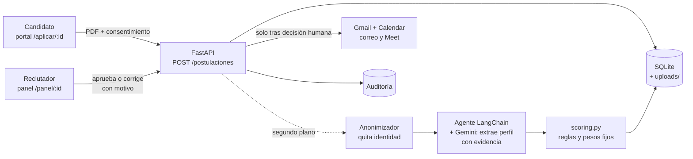

# Agente Evaluador

Grupo 3 · Agente evaluador de hojas de vida para **Nexo Digital S.A.S.**, una empresa de software ficticia de Medellín.

Un candidato se postula subiendo su HV en PDF y autorizando el tratamiento de sus datos (Ley 1581). Un agente **LangChain + Gemini** extrae sus competencias con evidencia textual, y **reglas fijas en Python** calculan un puntaje explicado por criterio. La IA solo recomienda: un **reclutador humano decide**, y solo entonces el sistema envía el correo y agenda la entrevista en Google Calendar.

El eje ético es parte del producto, no un anexo: evaluación ciega (se anonimiza antes del LLM), explicación por criterio, prueba de sesgo contrafactual, defensa contra *prompt injection*, humano en el bucle, auditoría y retención de datos. Detalle en [`docs/etica.md`](docs/etica.md).

## Documentos

| Documento | Para qué |
|---|---|
| [`PLAN.md`](PLAN.md) | Qué construimos, arquitectura, reglas de puntaje (§5), contratos, fases y pruebas (§11) |
| [`ONBOARDING.md`](ONBOARDING.md) | Preparar el computador, la API key de Gemini y Claude Code |
| [`docs/ESTADO.md`](docs/ESTADO.md) | Tablero vivo: qué está hecho, decisiones, hallazgos y deuda |
| [`docs/api.md`](docs/api.md) | Contrato de la API con ejemplos |
| [`docs/etica.md`](docs/etica.md) | Marco legal, riesgo → control → evidencia y resultados de sesgo |
| [`docs/demo.md`](docs/demo.md) | Guion de la demo de 5 minutos |
| [`CLAUDE.md`](CLAUDE.md) | Reglas de trabajo (git, TDD, datos) |

## Arranque rápido

Requisitos: Python 3.13, Node 20+ y Git. Comandos para Windows (Git Bash o PowerShell); en Mac/Linux cambia `.venv/Scripts` por `.venv/bin`.

**Backend** (puerto 8000, documentación interactiva en http://localhost:8000/docs):

```bash
cd backend
python -m venv .venv
.venv/Scripts/activate
pip install -r requirements.txt
cp .env.example .env            # pon tu GEMINI_API_KEY (ver ONBOARDING.md §2)
uvicorn app.main:app --reload --env-file .env
```

**Frontend** (puerto 5173; `frontend/.env.development` ya apunta al backend local):

```bash
cd frontend
npm install
npm run dev
```

Abre http://localhost:5173: portal del candidato en `/vacantes`, panel del reclutador en `/panel` y transparencia en `/como-evaluamos`.

### Variables que conviene conocer (`backend/.env`)

| Variable | Valores | Efecto |
|---|---|---|
| `EVALUADOR` | `real` (defecto) · `falso` | `falso` usa un evaluador simulado: **corre sin Gemini ni créditos**. El puntaje sale de los bytes del PDF, así que no refleja la HV |
| `MODO_EVALUACION` | `agente` (defecto) · `pipeline` | `agente` orquesta las herramientas con LangChain (~15–27 s por HV); `pipeline` hace una sola llamada al LLM, más rápido y barato |
| `GEMINI_MODEL` | `gemini-3.1-flash-lite` | Google renombra los modelos seguido |
| `DATABASE_URL`, `UPLOADS_DIR` | opcionales | BD SQLite y carpeta de PDF (por defecto `backend/agente.db` y `backend/uploads/`) |

> Pasa `--env-file .env` a uvicorn (como arriba) o exporta las variables en la terminal. Sin eso, `EVALUADOR` y `MODO_EVALUACION` solo se leen del `.env` después de la primera llamada a Gemini.

Para probar sin Gemini en un solo comando: `EVALUADOR=falso uvicorn app.main:app --reload` (PowerShell: `$env:EVALUADOR="falso"; uvicorn app.main:app --reload`).

Para poblar el panel con las HV sintéticas de `samples/`: `python -m scripts.sembrar_demo` (desde `backend/`, con el backend corriendo).

**Correo y Calendar (opcional):** sin `backend/token.json` la decisión se guarda igual y la auditoría registra `notificacion_omitida`. Para activarlos, sigue el docstring de `backend/scripts/autorizar_google.py` y corre `python -m scripts.autorizar_google`.

## Arquitectura

La IA extrae y justifica, Python puntúa y una persona decide. La evaluación corre en segundo plano: la API responde 201 al instante y el panel muestra el estado (`en_evaluacion` → `pendiente_revision` → `decidida`).



- **Backend:** FastAPI, SQLModel/SQLite, LangChain 1.x (`create_agent`) con `langchain-google-genai` sobre Vertex AI. Código en `backend/app/` (`routes.py`, `agent.py`, `scoring.py`, `anonymizer.py`, `google_apis.py`).
- **Frontend:** React + Vite + Tailwind, sin librería de estado. Código en `frontend/src/`.
- **Puntaje:** `0.45·técnico + 0.25·experiencia + 0.15·blandas + 0.10·educación + 0.05·idiomas`, tope de 40 si falta un obligatorio. ≥ 75 `ENTREVISTA`, 55–74 `REVISION_HUMANA`, < 55 `NO_CONTINUA` (PLAN §5).

## Pruebas

Todas se corren desde la carpeta indicada. El detalle de cada tipo está en PLAN §11.

| Tipo | Comando | Notas |
|---|---|---|
| Unitarias + caja negra (backend) | `cd backend && pytest --cov=app` | Sin Gemini. CI exige ≥ 80 % en `backend/app` |
| Evals con Gemini real | `cd backend && pytest -m llm` | Golden set de `samples/esperado.json`, *prompt injection* y reproducibilidad. **Cuesta créditos** y no corre en CI |
| Frontend (Vitest) | `cd frontend && npm test` | Componentes y cliente de la API |
| End-to-end (Playwright) | `cd e2e && npm install && npx playwright install chromium && npx playwright test` | Levanta solo backend (`EVALUADOR=falso`, BD temporal) y frontend; los puertos 8000 y 5173 deben estar libres. Incluye accesibilidad con axe |
| Carga (Locust) | ver el docstring de `load/locustfile.py` | Backend con `EVALUADOR=falso` y una BD desechable. Resultados en [`docs/carga/resultados.md`](docs/carga/resultados.md) |
| Sesgo contrafactual | `cd backend && python -m scripts.bias_test` | Gemini real, 8 variantes × 3 corridas. `--sin-anonimizar` para el contraste. Resultados en [`docs/sesgo/resultados.md`](docs/sesgo/resultados.md) |

## Datos y seguridad

- Secretos solo en `backend/.env`, `backend/credentials.json` y `backend/token.json`, todos en `.gitignore`.
- En `samples/` solo hay HV **sintéticas**. Las reales nunca se versionan (Ley 1581).
- `python -m scripts.purgar_datos` borra el PDF y la identidad de las postulaciones con más de 180 días.
- Límite conocido del MVP: el panel no tiene autenticación (ver `docs/etica.md` §6).

## Equipo

| Track | Persona |
|---|---|
| IA / Agente | Kevin |
| Frontend / Experiencia | Santiago |
| Plataforma / Integraciones | JVarz12 |
